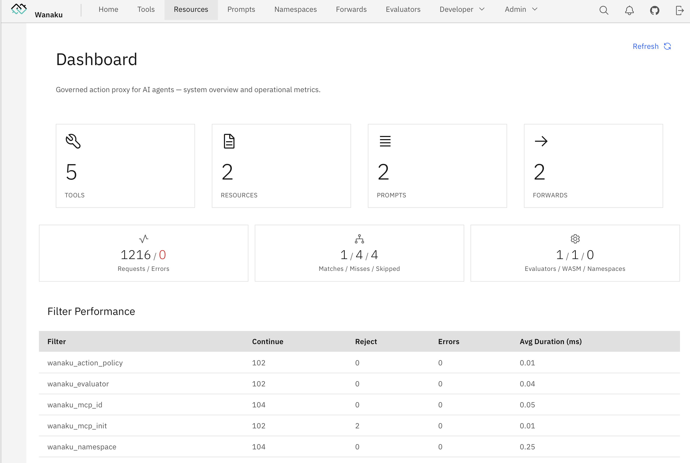

# Wanaku — A Governed Action Proxy for AI Agents

[](LICENSE)
[](https://github.com/wanaku-ai/wanaku/actions)
[](https://github.com/wanaku-ai/wanaku/releases)

Wanaku is a governed action proxy for AI agents. It sits between agents and the systems they act on, intercepting
[Model Context Protocol (MCP)](https://modelcontextprotocol.io/) tool calls, agent-to-agent messages, and inference
traffic. Before version 0.2.0, the project was named Wanaku MCP Router. It was renamed to Wanaku Governed Execution Proxy
to reflect its expanded scope.

Wanaku supports open standards for AI agents and provides first-class integration with enterprise frameworks,
including [Apache Camel](https://camel.apache.org/) and [Quarkus](https://quarkus.io/). For example, integration
developers build Apache Camel routes and use Wanaku's [Camel Integration Capability](https://github.com/wanaku-ai/camel-integration-capability)
to publish them as tools. Agents call those tools with parameters, but Wanaku runs the work. Agents never access backend
systems directly. The proxy enforces policy, identity, data controls, and audit requirements.

The project name comes from the origin of [guanaco](https://en.wikipedia.org/wiki/Guanaco), a camelid native to South America.

## Key Features

- **Agent Isolation** — Agents call tools through Wanaku; they never reach backend systems directly
- **Policy Enforcement** — LLM-powered evaluators + WASM action scripts classify, filter, and block tool calls in the proxy layer
- **Identity & Auth** — Authentication and authorization via oauth2-proxy and Keycloak, enforced before actions reach backends
- **Tool Discovery** — Auto-discover tools from upstream MCP servers; integration developers publish Camel routes as tools
- **Namespace Isolation** — Organize tools and resources across isolated namespaces per team, tenant, or environment
- **Extensible Architecture** — Plugin system via feature crates and a composable filter pipeline
- **Admin Dashboard** — Web UI for managing tools, resources, prompts, and forwards
- **Container-Ready** — Multi-arch images (x86_64, aarch64) published automatically

## Quick Start

### Install

On Linux or macOS, use this command to install the latest early-access build. Early-access builds are development builds of the unreleased Wanaku 0.3.0.

```bash
curl -fsSL https://raw.githubusercontent.com/wanaku-ai/wanaku/main/get-wanaku.sh | bash
```

The installer puts `wanaku-server` in `$HOME/bin`.

Other install methods are available. You can download the archive manually, use a container image, run Wanaku as a systemd service, or deploy it on Kubernetes or OpenShift. Read the [Getting Started](docs/getting-started.md) guide for the details of each method.

Run `wanaku-server`. Open <http://localhost:8080> to see the dashboard:



If you prefer a text interface, you may also download and use the Wanaku CLI from the [Wanaku Barn](https://github.com/wanaku-ai/wanaku-barn) project.

### Learn Wanaku

The easiest way to learn Wanaku is by following the **[guided tutorial](https://wanaku.ai/docs/demos/)**.

The reference documentation, including the complete installation and configuration instructions, is available in the [usage guide](https://wanaku.ai/docs/version/).

## Documentation

The **[Wanaku Documentation](https://wanaku.ai/docs/)** website contains the full project documentation.

Contributors working on the project may want to refer to the development documentation:

- [Getting Started](docs/getting-started.md) - Development setup guide
- [Architecture](docs/architecture.md) - System architecture and components
- [Configuration](docs/configuration.md) - Environment variables and configuration reference
- [Management API](docs/management-api.md) - API reference
- [Admin UI](docs/contributing-admin-ui.md) - Admin dashboard development
- [Features / Plugins](docs/features.md) - Feature crate system
- [Plugin Catalog](docs/plugin-catalog.md) - Publish and configure available UI plugins
- [Plugin Development](docs/plugin-development-guide.md) - Guide for writing admin UI plugins
- [Evaluator Engine](docs/evaluator-engine.md) - WASM-based evaluator
- [Action Policies](docs/action-policies.md) - Deterministic MCP action rules
- [Governance Posture](docs/governance-posture.md) - Enforcement modes and fail-safe behavior
- [Credential Brokerage](docs/credential-brokerage.md) - Scoped upstream credentials for forwards
- [FAQ](docs/faq.md) - Common problems and answers
- [Contributing](CONTRIBUTING.md) - Contribution guidelines
- [Security](SECURITY.md) - Security policy

## Community

- [GitHub Issues](https://github.com/wanaku-ai/wanaku/issues) - Bug reports and feature requests
- [Discussions](https://github.com/wanaku-ai/wanaku/discussions) - Ask questions and share ideas

## Related Projects

- [Wanaku Barn](https://github.com/wanaku-ai/wanaku-barn/) — Utilities for the Wanaku project: OpenShift/Kubernetes operator, CLI client, etc
- [Camel Integration Capability](https://github.com/wanaku-ai/camel-integration-capability/) — Build Apache Camel routes and publish them as tools that agents can call through Wanaku

## License

This project is licensed under the Apache 2.0 License - see the [LICENSE](LICENSE) file for details.
